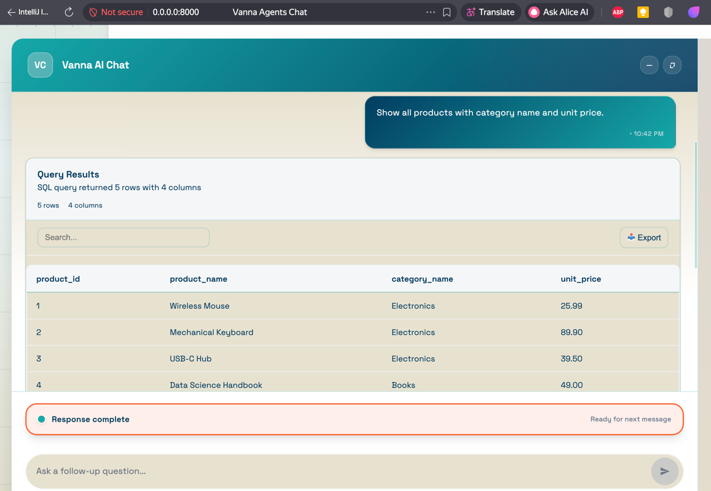

### Vanna AI v2 — FastAPI Server App

This app is a minimal reference implementation that runs a Vanna AI v2 Agent with a FastAPI server and a built‑in chat UI. It is configured via a `.env` file, uses the `uv` Python package manager, and runs on Python 3.13.



- Built‑in UI: `GET /` (served by Vanna’s FastAPI server)
- Health: `GET /health`
- Chat API (v2):
  - `POST /api/vanna/v2/chat_sse` (streaming via Server‑Sent Events)
  - `POST /api/vanna/v2/chat_poll` (polling)
  - `WS   /api/vanna/v2/chat_websocket` (WebSocket)
- FastAPI docs: `GET /docs`
- LLM providers: Anthropic (default), Google Gemini, OpenAI, Ollama
- Logging: INFO level by default

Reference: Vanna v2 README — https://github.com/vanna-ai/vanna/blob/v2/README.md


### Prerequisites

- Install `uv` (see https://docs.astral.sh/uv/):
  - Windows (PowerShell):
    ```powershell
    iwr https://astral.sh/uv/install.ps1 -UseBasicParsing | iex
    ```
- Ensure Python 3.13 is available via `uv`:
  ```powershell
  uv python install 3.13
  ```
- Optional: Ensure an Ollama server is running if you plan to use `LLM_PROVIDER=ollama`:
  - https://ollama.ai
  - Pull a model, e.g.: `ollama pull llama3`

### PostgreSQL Setup (Docker)

If you want to use the included PostgreSQL demo, follow these steps:

1. **Start PostgreSQL in Docker**:
   - On Windows: Run `postgres_server.bat`
   - On Linux/macOS: Run `sh postgres_server.sh` (ensure Docker is running)

2. **Initialize the Database**:
   Use the provided SQL script to create the demo schema and data:
   ```bash
   docker exec -i postgres psql -U postgres -d postgres < demo/postgres-demo.sql
   ```

3. **Configure `.env`**:
   Ensure your `.env` file points to the local PostgreSQL instance:
   ```env
   DB_DIALECT=postgres
   DB_HOST=localhost
   DB_PORT=5432
   DB_USER=postgres
   DB_PASSWORD=postgres
   DB_NAME=postgres
   ```

4. **Try example questions in the chat UI**:
   After starting the app, try asking:
   - "List all customers with their city and country."
   - "Show all products with category name and unit price."
   - "What are the total sales per order?"
   - "Who are the top customers by revenue in 2024?"
   - "Show revenue by customer and year."
   - "What is the total revenue for each product?"
   - "How many orders did each customer make?"
   - "What is the average order amount?"
   - "Which category has the highest total sales?"
   - "Show monthly revenue trend for 2024."


### Setup

1) Clone and enter the project folder, then create your environment file:
   ```powershell
   Copy-Item .env.example .env
   # Edit .env to set DB and LLM credentials
   ```

2) Install dependencies using uv (reads `pyproject.toml`):
   ```powershell
   uv sync
   ```

### Configuration (.env)

See `.env.example` for all options. Key variables:

- App and logging
  - `APP_HOST` (default `0.0.0.0`), `APP_PORT` (default `8000`), `APP_DEBUG` (`true`/`false`)
  - `LOG_LEVEL` (default `INFO`)

- LLM provider
  - Default: Anthropic Sonnet (`LLM_MODEL` can override model name)
  - Google Gemini: set `LLM_PROVIDER=google` (or `gemini`) and `GOOGLE_API_KEY`
  - OpenAI: set `LLM_PROVIDER=openai` and `OPENAI_API_KEY`
  - Ollama: set `LLM_PROVIDER=ollama`
    - `OLLAMA_BASE_URL` (default `http://localhost:11434`)
    - `OLLAMA_MODEL` (default `llama3`)

Note: This app is configured to use the `PostgresRunner` by default. If you want to connect tools to another database (e.g., Oracle or SQLite), register an appropriate `RunSqlTool` in `app/main.py`.


### Optional: Database tooling

By default, `app/main.py` registers a `RunSqlTool` with a `PostgresRunner` as a simple example. To target your own database (Oracle, SQLite, etc.), replace that tool with the appropriate Vanna integration in `main.py` and ensure required drivers are installed.


### Running the app

- Development server:
  ```powershell
  uv run vanna_app
  # or
  uv run python -m app.main
  ```

- Open in your browser: http://localhost:8000
  - Built‑in UI: `GET /`
  - Health: `GET /health`
  - API docs: `GET /docs`

The service exposes Vanna’s v2 chat endpoints (`/api/vanna/v2/*`) for SSE, polling, and WebSocket.


### Notes on providers

- Anthropic: default when `LLM_PROVIDER` is unset. Set `LLM_MODEL` to change model name.
- Google Gemini: requires `GOOGLE_API_KEY` and uses `gemini-2.5-pro` if `LLM_MODEL` is unset.
- OpenAI: requires `OPENAI_API_KEY` and uses `gpt-5` if `LLM_MODEL` is unset.
- Ollama: ensure `OLLAMA_BASE_URL` points to a running server and that you’ve pulled a model. Default model name used is `OLLAMA_MODEL`.


### Project structure

```
app/
  __init__.py
  config.py          # .env configuration loader
  logging_config.py  # INFO level logging
  main.py            # FastAPI app (Vanna v2 server) and entrypoint
demo/
  postgres-demo.sql  # (optional) sample schema/data for Postgres
.env.example
pyproject.toml
README.md
```


### Troubleshooting

- If the server fails to start, ensure dependencies are installed (`uv sync`) and that your selected LLM provider is available.
- For Ollama, confirm the local server is running and the model is pulled.
- On Windows with corporate proxies, set `HTTP_PROXY`/`HTTPS_PROXY` as needed for dependency installs and provider access.


### License

MIT (or your preferred license).
